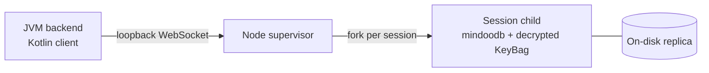

# mindoodb-kmp-client

A Kotlin Multiplatform client that gives a JVM backend read/write access to
MindooDB — documents, ad-hoc `query`, virtual views, full-text search,
attachments (both directions), the changefeed, and live updates — **without
porting the TypeScript engine to the JVM**.

The real `mindoodb` engine runs in a Node **sidecar** ([`mindoodb-jvm-bridge`](../mindoodb-jvm-bridge))
that holds the decrypted keys; this module is a thin, coroutine-first transport
client that talks to it over a loopback WebSocket. The wire contract is
documented in [`../mindoodb-jvm-bridge/PROTOCOL.md`](../mindoodb-jvm-bridge/PROTOCOL.md).



- **One session = one WebSocket connection = one isolated sidecar child process.**
  Open one session per user; their on-disk replicas and in-memory keys never mix.
- The module is KMP-structured (`commonMain` is pure Kotlin over a `Transport`
  abstraction) so a mobile target can later supply its own transport. Today the
  only implemented target is `jvm`.

## Requirements

- JDK 21+
- Node.js `>=22.13.0` with the sidecar built (see [Building the sidecar](#building-the-sidecar)).

## Add to a build

This module currently builds from source in the workspace. From `mindoodb-kmp-client/`:

```bash
./gradlew build            # compile + test
./gradlew jvmTest          # run the end-to-end integration test
```

Runtime dependencies (managed by the module): `kotlinx-coroutines`,
`kotlinx-serialization-json`, Ktor client (`core` + `websockets`, CIO engine on JVM).

## Quick start

```kotlin
import com.mindoo.db.bridge.*
import java.nio.file.Paths
import kotlinx.coroutines.flow.first
import kotlinx.coroutines.runBlocking

val bridgeDir = Paths.get("..", "mindoodb-jvm-bridge").toAbsolutePath().normalize()
val dataRoot = Paths.get("./bridge-data")

runBlocking {
    // 1. Start the supervisor.
    val sidecar = Sidecar.start(bridgeDir.resolve("dist/index.js"), dataRoot)

    // 2. First-time setup: create a tenant + app user + identity bundle on disk.
    //    (See "Provisioning" below.) Idempotent to skip if the bundle exists.
    val created = MindooDBBridge.createTenant(
        endpoint = sidecar.endpoint,
        tenantId = null,                   // null = random, time-sortable ID (like Haven)
        tenantLabel = "Acme",              // the name members see; the admin can rename it
        adminName = "cn=admin/o=acme",
        adminPassword = "admin-pw",
        userId = "cn=alice/o=acme",
        password = "alice-pw",
        databases = listOf("notes"),
    )

    // 3. Open a session for the provisioned user.
    val session = MindooDBBridge.openSession(
        endpoint = sidecar.endpoint,
        tenantId = created.tenantId,
        userId = "cn=alice/o=acme",
        password = "alice-pw",
        databases = listOf("notes"),
    )

    val db = session.database("notes")

    // 4. Create / update / read documents.
    val doc = db.documents.create(mapOf("type" to "note", "title" to "Hello"))
    db.documents.update(doc.id, baseHeads = doc.heads) {
        set("title", "Hello (edited)")
        merge(mapOf("tags" to listOf("kotlin", "mindoodb")))
    }
    val reloaded = db.documents.get(doc.id)

    // 5. Attachments (upload then stream back down).
    db.attachments.uploadBytes(doc.id, "note.txt", "text/plain", "big payload".encodeToByteArray())
    db.attachments.read(doc.id, "note.txt").collect { chunk -> /* consume bytes */ }

    // 6. Follow the changefeed.
    val firstChange = db.changes(sinceCursor = null).first()

    session.close()   // reaps the sidecar child
    sidecar.stop()
}
```

If the supervisor is already running (started out-of-band), skip `Sidecar.start`
and connect with the handshake values directly:

```kotlin
MindooDBBridge.openSession(
    host = "127.0.0.1", port = 51734, bootstrapToken = "…",
    tenantId = "acme", userId = "cn=alice/o=acme", password = "alice-pw",
    databases = listOf("notes"),
)
```

## API surface

Everything is `suspend` or `Flow`-based and carries the per-session token
automatically.

### Session — `MindooDBSession`
`database(id)`, `listDatabases()`, `refresh(dbId?, direction)`, `awaitIndexReady(dbId?)`,
`close()`.

`refresh` syncs now (`SyncDirection.Both`/`Pull`/`Push`) and returns per-database
counters (`pulledEntries`, `pushedEntries`, `rejectedEntries`). Without it a
background loop syncs every 5 s once a server URL is set;
`setBackgroundSync(false)` turns it off for the session (handy to test
concurrent edits), `isBackgroundSyncEnabled()` reads it. Sync always covers
`directory` and `userdirectory` (grants, key wraps) plus every open local
database, documents and attachments.

### Documents — `db.documents` (`DocumentApi`)
`get(docId, withFieldTypes?)`, `applyEdit(original, edited)`, `list(idPrefix?)`, `headCursor()`,
`create(initialValues?, id?, idPrefix?, decryptionKeyId?)`, `createMany`,
`update(docId, baseHeads?) { … }`, `delete`, `deleteMany`, `listDeleted`,
`undelete`, `history`, `getAtRevision(docId, timestamp)`.

`update` takes an ops block (`set` / `setAtomic` / `setText` / `unset` / `merge` /
`textSplice` / `increment` / `listInsert` / `listDelete`), applied as one change,
and returns `UpdateResult(heads, conflictExpected?)`. Pass the document's prior
`heads` as `baseHeads`: the change is made against that version and merged into
the current one, and `conflictExpected` flags that the document had moved on.

A plain string is collaborative text (concurrent edits merge character-wise).
For IDs, status and enum values use `setAtomic` or `MindooValue.atomic(...)`;
`MindooValue.counter(n)` with `increment(...)` gives a counter whose concurrent
increments add up; `MindooValue.timestamp(ms)` stores a date.

```kotlin
db.documents.update(doc.id, baseHeads = doc.heads) {
    setAtomic("status", "open")
    set("views", MindooValue.counter(0))
    setText("body", "Collaborative text")
}
db.documents.update(doc.id) { increment("views") }
```

**Saving an edited JSON copy.** An editor that shows a document as JSON can save
with `applyEdit(original, edited)`: `JsonEditDiff` compares the edited copy with
`original.data` and writes only the difference, at `original.heads`, as text
splices for text, list inserts/deletes, increments for counters and new values
for the rest. Two people who edited the same version, even different words of
one text or different keys of one nested object, both keep their edit. Load the
original with `get(id, withFieldTypes = true)`, so atomic strings stay atomic.

```kotlin
val original = db.documents.get(id, withFieldTypes = true)
val edited = Json.parseToJsonElement(editorText).jsonObject
db.documents.applyEdit(original, edited)   // null when nothing changed
```

**Rich text and marks.** `richText(path, spans)` writes a rich-text field
(`RichTextSpan.Block` / `RichTextSpan.Text(value, marks)`); MindooDB diffs the
spans, so concurrent edits elsewhere in the field survive. `richTextSteps(path,
steps)` makes positional edits (`RichTextStep.Splice` with optional marks),
`textMark` / `textUnmark` format a range of any collaborative text.
`getRichText(docId, path)` reads spans with marks plus the `heads` to pass as
`baseHeads` of the next edit; `get` only returns the plain string (a block
counts as one `\uFFFC` character).

```kotlin
val bold = buildJsonObject { put("bold", true) }
db.documents.update(doc.id) {
    richText(listOf("content"), listOf(
        RichTextSpan.Block(buildJsonObject { put("type", "paragraph") }),
        RichTextSpan.Text("Hello "), RichTextSpan.Text("world", bold),
    ))
}
val snap = db.documents.getRichText(doc.id, listOf("content"))
db.documents.update(doc.id, baseHeads = snap.heads) {
    textMark(listOf("content"), index = 1, length = 5, marks = mapOf("italic" to true))
}
```

**Text cursors.** `getTextCursors(docId, path, positions)` returns opaque
cursors that keep pointing at the same character while others edit the text
(anchor comments or highlights; store them with `setAtomic`).
`resolveTextCursors(docId, path, cursors, heads?)` turns them back into indexes,
now or at an older version.

### Query, views, full-text — `db`
- `query(mindooQuery { … })` → `QueryResult`
- `liveQuery(query)` → `Flow<QueryResult>` (re-emits on change)
- `changes(sinceCursor?, idPrefix?)` → `Flow<DocumentChange>` (replay then follow live);
  `changeMetadata(...)` the same without decrypting documents
- `readChanges(sinceCursor?, limit, idPrefix?)` → `ChangePage(changes, cursor, done)`:
  one page up to the current end, no live part (`readChangeMetadata` for ids
  and deleted flags only, `changesUntilNow` pages through everything,
  `countChanges` counts what is left). Persist the cursor with
  `ChangeCursors.serialize` / `parse`:

```kotlin
var stored: String? = loadCursor()
do {
    val page = db.readChanges(ChangeCursors.parse(stored), limit = 500, idPrefix = "inv")
    page.changes.forEach { export(it.doc) }
    stored = ChangeCursors.serialize(page.cursor)
    saveCursor(stored)             // after the page is processed
} while (!page.done)
```
- `openViewNavigator(viewDefinition { … })` → `ViewNavigator`
- `getFulltextSetup()` / `setFulltextSetup(config)`

Full-text search is a `text` clause on a query (`textScore` per row appears on
matches).

Query / view DSL: the complete MindooDB view language (`createViewLanguage()`), so any
filter, sort key or column formula a TypeScript app writes with `v.…` can be written in Kotlin.
Arguments typed `Any?` take an expression or a plain value (a literal).

| Group | Functions |
|---|---|
| Values | `lit`, `str`, `num`, `bool`, `field("a.b")`, `value(column)`, `origin()`, `parent(field)` |
| Document metadata | `docId()`, `parentDocId()`, `createdAt()`, `lastModifiedAt()`, `decryptionKeyId()`, `isWitnessed()`, `isAwaitingWitness()`, `attachmentNames()`, `attachmentLengths()`, `attachmentCount()` |
| View counters | `childCount()`, `childCategoryCount()`, `childDocumentCount()`, `descendantCount()`, `descendantCategoryCount()`, `descendantDocumentCount()`, `siblingCount()` |
| Arithmetic | `+ - * / %` on expressions, or `add`, `sub`, `mul`, `div`, `mod` |
| Comparison, logic | `eq`, `neq`, `gt`, `gte`, `lt`, `lte`, `and`, `or`, `not`, `allOf`, `anyOf` |
| Text | `concat`, `lower`, `upper`, `trim`, `left`, `right`, `contains`, `startsWith`, `endsWith`, `pathJoin` |
| Conversion, nulls | `asNumber`, `asString`, `asBoolean`, `coalesce`, `exists`, `notExists`, `datePart(x, DatePart.Year/Month/Day/Quarter)` |
| Encrypted, JSON | `decryptField`, `decryptJson`, `json(field, path)` |
| Branching | `ifElse(cond, a, cond2, b, default)`, `let("x" to expr) { it["x"] * 2 }` |
| Anything newer | `rawExpr(json)` |

Queries also take formula source text (`filterFormula = "v.eq(v.field(\"type\"), \"note\")"`), sort
keys by expression (`sort(lower(field("name")))`), and joins: `include("customer", Cardinality.One)
{ db = "crm"; localKey = "customerId" }` adds the related row (read it with `row.included("customer")`;
`Cardinality.Many` + `row.includedList(…)`). Views take `categorizationStyle`, typed `sorting`/`totals`
per column, and `sources` to span several databases (`ViewSource("crm", filter = …, origin = "crm")`).


```kotlin
val q = mindooQuery {
    filter = (field("type") eq "time") and (field("hours") * field("rate") gt 40)
    sort(lower(field("employee")))
    include("customer", Cardinality.One) { db = "crm"; localKey = "customer" }
    limit = 50
}
val label = let("h" to field("hours")) { ifElse(it["h"] gte 8, "full day", it["h"] gt 0, "part time", "off") }

val view = viewDefinition {
    filter = field("type") eq "time"
    category("bucket", expression = pathJoin(datePart(field("day"), DatePart.Year), field("employee")))
    column("amount", field("hours") * field("rate"), totals = TotalMode.Sum, sorting = ColumnSorting.Descending)
    column("label", label)
}
val nav = db.openViewNavigator(view, navigatorOptions = navigatorOptions(expandAll = true))
val rows = nav.readForward(limit = 100)   // also: gotoFirst/Next/Parent/Pos…, expand…, select…, readSelected
nav.changes().collect { nav.readForward() } // view follows the database while collected
nav.refresh()                               // or update it on demand
nav.close()
```

### Attachments — `db.attachments` (`AttachmentApi`)
`list`, `remove` / `removeById`, `read(docId, fileName)` / `readById` → `Flow<ByteArray>`,
`upload(docId, fileName, mimeType, chunks: Flow<ByteArray>)`,
`uploadBytes(...)`. Transfers use credit-based flow control in both directions.

`java.io` interop (jvmMain): `InputStream.asByteFlow()` and
`Flow<ByteArray>.asInputStream(scope)`.

## Provisioning — creating tenants & users

Provisioning happens over the same bridge, as **bootstrap RPCs** that run after
`hello` but before (and without) opening a session — authorized by the bootstrap
token and rate-limited alongside `session.open`.

`MindooDBBridge.createTenant(...)` creates the tenant + admin + app user, writes
a password-locked identity bundle, and returns `CreatedTenant` including
`adminIdentity` (for join approval). `openSession` reopens the app-user bundle.

```kotlin
val created = MindooDBBridge.createTenant(
    endpoint = sidecar.endpoint,
    tenantId = null, tenantLabel = "Acme", adminName = "cn=admin/o=acme", adminPassword = "admin-pw",
    userId = "cn=alice/o=acme", password = "alice-pw", databases = listOf("notes"),
)
val session = MindooDBBridge.openSession(
    sidecar.endpoint, created.tenantId, created.userId, "alice-pw", created.databases,
)

// Tenant name (admin renames, every member reads it after a sync)
session.setTenantLabel("Acme Corp", adminPassword = "admin-pw")
session.getTenantLabel()

// KeyBag
session.createDocKey("finance")
session.listKeys()

// Open another DB (local replica, or remote-primary via ClientNetwork store)
session.openDatabase("tasks", DatabaseMode.Local)

// Publish to a MindooDB sync server. Pushes directory + userdirectory as the
// tenant admin and starts background sync. System-admin credentials are only
// needed when the server does not let any signed user register tenants.
session.publishToServer(url, adminPassword = "admin-pw")
// session.publishToServer(url, systemAdminIdentity, systemAdminPassword, adminPassword = "admin-pw")
session.refresh()

// Watch sync progress (refresh, publish, approval and background syncs)
// launch { session.syncProgress().collect { println("${it.dbId} ${it.direction} ${it.phase} ${it.transferredEntries}") } }

// Join flow (the approval pushes the grant when the session has a server URL)
val bob = MindooDBBridge.createUser(sidecar.endpoint, "cn=bob/o=acme", "bob-pw")
val req = MindooDBBridge.createJoinRequest(sidecar.endpoint, bob.identity, label = "Billing service")
val info = session.inspectJoinRequest(req.joinRequest)   // name, label, fingerprints, already known?
val approved = session.approveJoinRequest(
    req.joinRequest, adminPassword = "admin-pw", adminIdentity = created.adminIdentity,
)
val joined = MindooDBBridge.joinTenant(
    sidecar.endpoint, approved.joinResponse, bob.identity, "bob-pw",
    databases = listOf("notes"),   // pulls the directory from the server first
)
```

Also: `createUser`, `createJoinRequest`, `joinTenant`, `setServerUrl`,
`publishToServer`. `Sidecar.provision(...)` remains as a CLI alternative.

## Security

Loopback-only bind + peer check; a mode-`600` bootstrap-token handshake file
authorizes the connection; the user's password unlocks the KeyBag once and is
then discarded; a per-session, memory-only, idle-expiring token authorizes every
frame; `session.open` and bootstrap provisioning are rate-limited; each session runs in its own OS process
for memory isolation of decrypted keys; the child is killed on `close()`, idle
timeout, disconnect, or supervisor exit. See PROTOCOL.md §7.

## Building the sidecar

```bash
# from the workspace root
pnpm --filter mindoodb-jvm-bridge install
pnpm --filter mindoodb-jvm-bridge build   # produces dist/index.js and dist/provision.js
```

## Tests

`BridgeIntegrationTest` (jvmTest) spawns the real sidecar, provisions two
isolated users, and exercises read/write, cross-session isolation, an attachment
round-trip, the changefeed, and history. It skips gracefully if the sidecar
`dist/` or `node` is unavailable.

`JsonEditDiffTest` checks the operations `JsonEditDiff` emits (and replays random
text and list edits); `JsonEditIntegrationTest` saves two edits of one version
through the sidecar and checks that both survive, typed values included.

`ServerSyncIntegrationTest` syncs two users of one tenant through a real MindooDB
server (publish, join, documents, attachments, typed values, a live view). It
runs when `MINDOODB_TEST_SERVER_URL` is set; the server must let any signed user
register tenants (setup in the sidecar README, "Tests").

```bash
./gradlew jvmTest
MINDOODB_TEST_SERVER_URL=http://127.0.0.1:1761 ./gradlew jvmTest
```
